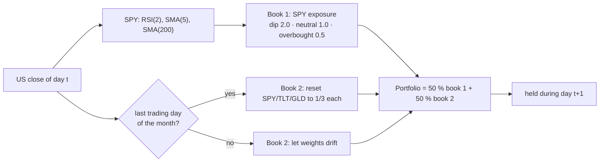
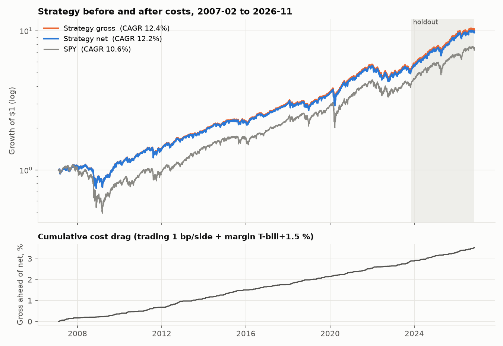
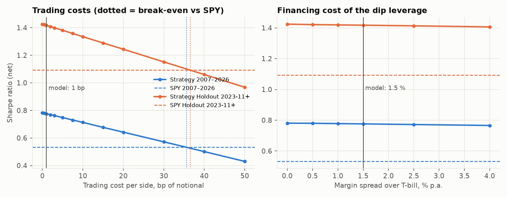
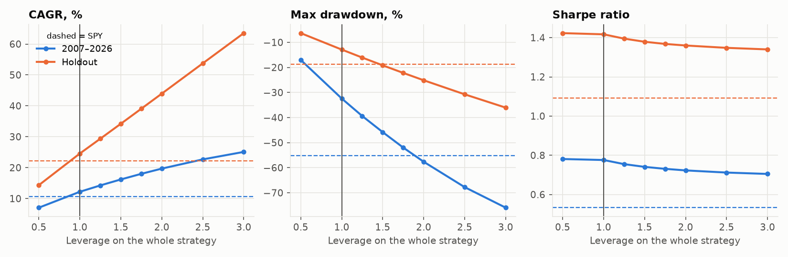
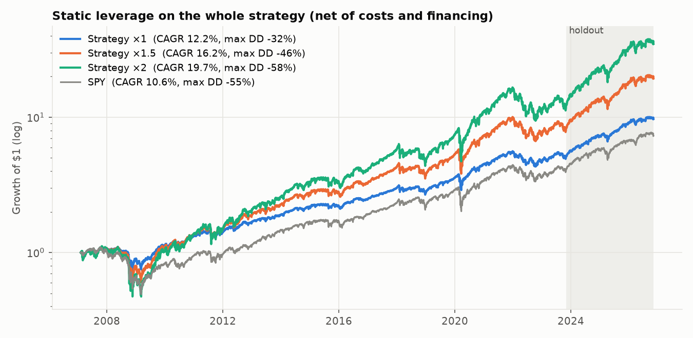
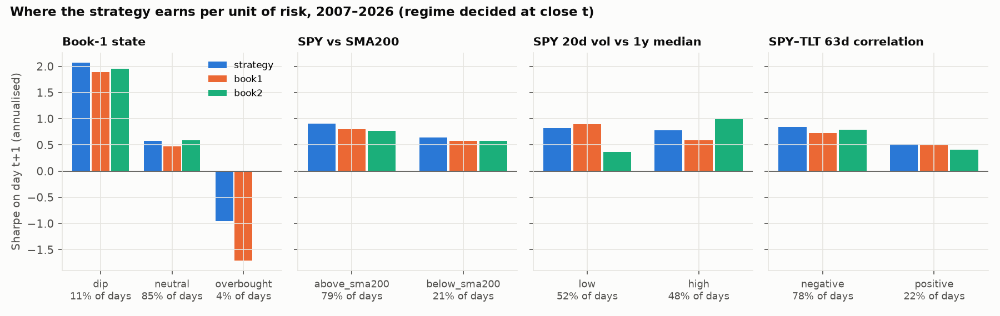
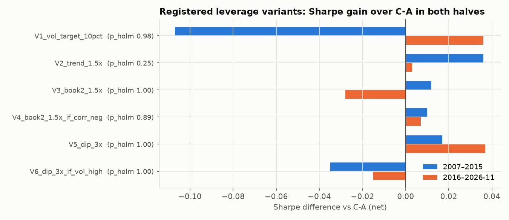

# Regime-Diversified Mean Reversion

A long-only, daily-rebalanced US portfolio that combines two **mean-reversion** mechanisms which pay in different market regimes:

1. **Index dip overlay (book 1).** Hold SPY. After an oversold close in an uptrend, double the exposure until the bounce. After an overbought close in a downtrend, halve it.
2. **Cross-asset rebalancing premium (book 2).** Hold SPY, long Treasuries (TLT) and gold (GLD) in equal thirds and rebalance back at every month end. Rebalancing sells relative winners and buys relative losers.

The strategy (internally called **C-A**) puts **50 % of capital in each book**.

In a holdout period that was not touched until the strategy was selected and frozen (**2023-11-01 to 2026-11-06**), it beat the S&P 500 on a risk-adjusted basis. The difference is not statistically significant. Read the [caveats](#honest-caveats) before relying on it.

| Holdout 2023-11-01 – 2026-11-06 (757 trading days) | Strategy | SPY (S&P 500) |
|---|---:|---:|
| Sharpe ratio (excess over 3-month T-bill) | **1.42** | 1.09 |
| Sortino ratio | 2.01 | 1.42 |
| Volatility p.a. | 13.1 % | 15.4 % |
| CAGR (total return) | 24.6 % | 22.1 % |
| Max drawdown (total return) | −12.9 % | −18.8 % |
| Monthly win rate | 70.3 % | 67.6 % |
| Paired Sharpe test (Jobson-Korkie / Memmel) | diff +0.33, ρ 0.92, **p = 0.165** | |
| Bootstrap 95 % CI of the Sharpe | [0.34, 2.47] | |

**Contents**

1. [How the strategy works](#1-how-the-strategy-works)
2. [The economic theory](#2-the-economic-theory)
3. [Exact rules](#3-exact-rules)
4. [Results in every period](#4-results-in-every-period)
5. [Gross vs net and cost sensitivity](#5-gross-vs-net-and-cost-sensitivity)
6. [Win rates](#6-win-rates)
7. [Leverage](#7-leverage)
8. [Where leverage can be used strategically](#8-where-leverage-can-be-used-strategically)
9. [Honest caveats](#honest-caveats)
10. [How to run](#how-to-run) · [Repository layout](#repository-layout) · [Research provenance](#research-provenance-what-did-not-work)

---

## 1. How the strategy works



**Book 1 – buying index dips in bull markets.** Most of the time book 1 simply holds SPY (exposure 1.0). When SPY has fallen hard for one or two days (RSI(2) below 10) *while* it is still above its 200-day average, the book doubles to 2.0 × SPY. It goes back to 1.0 as soon as SPY closes above its 5-day average – usually after 2–4 days. The mirror rule halves the exposure to 0.5 when SPY has rallied sharply (RSI(2) above 90) *below* its 200-day average, until it closes below its 5-day average again. Book 1 is in a dip state on about 11 % of days and in an overbought state on about 4 %.

**Book 2 – harvesting the rebalancing premium.** Book 2 holds one third each of US stocks (SPY), long Treasuries (TLT) and gold (GLD). Within a month the weights drift with prices. On the last trading day of every month they are reset to one third each, which mechanically sells what has risen relative to the others and buys what has fallen.

**The combination.** The two books are 49 % correlated with each other (2007–2026). Book 1 earns most in volatile, liquidity-driven sell-offs inside bull markets; book 2 earns most when stocks, bonds and gold move against each other. A typical position for 1.0 of capital:

| Holdings for 1.0 of capital | No signal | Dip | Overbought |
|---|---:|---:|---:|
| SPY | 0.50 + 0.5·w_SPY ≈ 0.67 | 1.00 + 0.5·w_SPY ≈ 1.17 | 0.25 + 0.5·w_SPY ≈ 0.42 |
| TLT | 0.5·w_TLT ≈ 0.17 | ≈ 0.17 | ≈ 0.17 |
| GLD | 0.5·w_GLD ≈ 0.17 | ≈ 0.17 | ≈ 0.17 |
| Cash (+) / borrowed (−) | 0 | −0.50 | +0.25 |

The maximum gross exposure is 1.5 (in a dip), the average 1.05. The portfolio turns over about 10 × its capital per year (sum of absolute weight changes), mostly from the dip overlay.

---

## 2. The economic theory

A strategy without an economic cause is a pattern found in noise. Both books rest on mechanisms that are documented in the academic literature, that have an identifiable counterparty and that explain *when* the strategy should fail.

### 2.1 Book 1: short-term index reversal is a liquidity-provision premium

**The mechanism.** Prices do not only move because information arrives. They also move because someone *has to* trade now: a fund meeting redemptions, a leveraged trader meeting a margin call, a volatility-targeting fund cutting exposure after a jump in volatility, a CTA flipping its trend signal, an options dealer hedging short gamma. These traders demand immediacy. Someone has to take the other side, carry the inventory risk and wait for the price to recover. In the model of Grossman & Miller (1988) the expected return of that liquidity provider is the price of immediacy: the larger the temporary order imbalance and the scarcer the risk-bearing capital, the larger the subsequent reversal.

**Evidence.**
- Lehmann (1990) and Lo & MacKinlay (1990) document short-horizon return reversals; Campbell, Grossman & Wang (1993) show that price drops on *high volume* – i.e. non-informational selling – are the ones that reverse.
- Nagel (2012, "Evaporating Liquidity") shows that the return to reversal strategies is a compensation for liquidity provision and that it rises sharply with the VIX: when volatility is high, liquidity providers have less capital, so the price of immediacy goes up.
- Brunnermeier & Pedersen (2009) link market liquidity to funding liquidity: falling prices tighten margins, which forces more selling. This spiral is what creates the temporary overshoot that book 1 buys.

**Why only above the 200-day average.** A price drop can be a liquidity shock (temporary) or news (permanent). The share of temporary shocks is larger in calm bull markets, where the main sellers are mechanical. Below the long-run trend, falling prices more often reflect news and tend to continue – the domain of time-series momentum (Moskowitz, Ooi & Pedersen 2012). The SMA(200) filter is a simple, transparent way to buy only the dips that are more likely to be liquidity-driven. Connors & Alvarez (2008) popularised exactly this RSI(2)/SMA(200) combination for index ETFs.

**Why halve the exposure on overbought closes in a downtrend.** The mirror image of the dip: in a bear market, sharp rallies are often short-covering and hedges being lifted, not new buyers. They tend to fade. In the data, SPY's next-day Sharpe after such a close is −1.7 (annualised, 4 % of days, see [§ 8](#8-where-leverage-can-be-used-strategically)). The book cuts rather than shorts, so a wrong signal costs little.

**Who loses.** Investors who are forced or rule-bound to sell into a decline (leverage constraints, risk limits, volatility targets, redemptions), and investors who cannot add exposure in a dip because they are already fully invested or constrained by leverage (Frazzini & Pedersen 2014). A small, unconstrained account can supply the liquidity.

**When it fails.** When a "dip in a bull market" is the start of a crash: August 2011 (−10.1 % on the overlay in book-1 units, the worst trade), February 2020 (−4.0 %), February 2018 (−3.6 %). And in calm markets with few dips, the overlay simply does nothing.

### 2.2 Book 2: the rebalancing premium (diversification return)

**The mechanism.** For any asset the long-run (geometric) growth rate is approximately

$$g \approx \mu - \tfrac{1}{2}\sigma^2,$$

i.e. volatility drags compound growth below the average (arithmetic) return. A portfolio that is *rebalanced* to fixed weights $w_i$ has the arithmetic return $\sum_i w_i \mu_i$ but only the portfolio variance $\sigma_p^2$ as drag. A portfolio that is never rebalanced eventually grows like its components. The difference between the growth of the rebalanced portfolio and the weighted growth of its parts is the **diversification return** (Booth & Fama 1992; Erb & Harvey 2006; Willenbrock 2011):

$$\text{DR} = \tfrac{1}{2}\Big(\sum_i w_i \sigma_i^2 - \sigma_p^2\Big) \;\ge\; 0.$$

It is large when the assets are volatile *and* weakly or negatively correlated – exactly what stocks, long Treasuries and gold are. Across SPY, TLT and GLD (2005–2015 average correlation −0.10) it is about 1.2 % p.a., three times the 0.4 % available among US equity sectors (correlation 0.75).

**Why it is a mean-reversion strategy.** Rebalancing sells the asset that has risen relative to the others and buys the one that has fallen. It earns money when relative prices oscillate and loses (relative to buy-and-hold) when one asset trends away from the others for a long time. Perold & Sharpe (1988) call constant-mix strategies "concave": they are effectively short a straddle on *relative* performance and are paid a premium for providing that insurance. This is the same economic role as book 1 – supplying liquidity to whoever is moving prices – just across asset classes and at a monthly horizon.

**Why these three assets.** They respond to different macro risks:
- **Stocks** to growth and risk appetite.
- **Long Treasuries** to discount rates and, in growth scares, to flight-to-quality. In the era of anchored inflation (roughly 2000–2021) the stock–bond correlation was negative, so bonds rallied when stocks fell (Campbell, Sunderam & Viceira 2017; Baele, Bekaert & Inghelbrecht 2010).
- **Gold** to real interest rates, currency debasement and tail risk; it has acted as a crisis safe haven for equities (Baur & Lucey 2010), but its fair value is notoriously hard to pin down (Erb & Harvey 2013).

**When it fails.** When the stock–bond correlation turns positive – typically in inflation-driven regimes like 2022, when stocks and bonds fell together. Then there is less relative oscillation to harvest and the bond leg adds risk instead of diversification. This is why the 2020–2023 validation segment was weak and why the rolling SPY–TLT correlation is a regime indicator worth watching (see [§ 8](#8-where-leverage-can-be-used-strategically)).

### 2.3 Why combine the two books

A pure overlay on SPY raises the Sharpe ratio only if the overlay's own Sharpe exceeds ρ × Sharpe(SPY), where ρ is the overlay's correlation with SPY. This is almost impossible in a calm bull market, when SPY's Sharpe is high and dips are rare. The two books earn in different regimes: in validation, book 1 earned in 2020–23 (Sharpe 0.64 vs SPY 0.41) and book 2 in 2016–19 (1.28 vs 1.00). Their 50/50 combination diversifies *regime* risk, not just asset risk. The pure dip overlay (book 1 minus SPY) has a Sharpe of 0.67 over 2007–2026 and a correlation of only 0.21 with SPY.

### 2.4 Why the edge can persist

Neither premium is a free lunch that arbitrage should remove. Both are payments for bearing a risk that constrained investors want to get rid of: inventory risk during sell-offs (book 1) and the risk of a long relative trend (book 2). Both are capacity-limited and uncomfortable – they lose precisely in crashes and in persistent trends. That discomfort is the reason they are paid.

---

## 3. Exact rules

All signals are computed from the **close of day t** and held during **day t+1**. Signals use only data up to and including t, as tested in `tests/`.

**Book 1: SPY exposure in [0.5, 2.0]**
- RSI(2) is Wilder's RSI over 2 days. SMA(n) is the simple moving average of closes.
- *Dip state:* entered when RSI(2) < 10 **and** close > SMA(200). Left when close > SMA(5).
- *Overbought state:* entered when RSI(2) > 90 **and** close < SMA(200). Left when close < SMA(5).
- Exposure = clip(1 + dip − 0.5 · overbought, 0.5, 2.0).
- Exposure above 1.0 is financed at T-bill + 1.5 % p.a. Unused capital earns the T-bill rate.

**Book 2: SPY / TLT / GLD**
- Reset to 1/3 each at the close of the last trading day of every month. In between, the weights drift with prices (no trading).

**Strategy:** 50 % of capital in book 1, 50 % in book 2.

**Costs and cash:** 1 bp of traded notional per side, with exact turnover against the drifted holdings. Cash and all Sharpe ratios use the FRED 3-month T-bill rate (DTB3).

---

## 4. Results in every period

| Period | Role | Strategy Sharpe | SPY Sharpe | Strategy max DD | SPY max DD |
|---|---|---:|---:|---:|---:|
| 2007 – 2015 | pre-validation check | 0.63 | 0.35 | −32.4 % | −55.2 % |
| 2016 – 2019 | validation, segment 1 | 1.13 | 1.00 | −14.9 % | −19.4 % |
| 2020 – 2023-10 | validation, segment 2 | 0.52 | 0.41 | −23.6 % | −33.7 % |
| **2023-11 – 2026-11** | **holdout (one run)** | **1.42** | **1.09** | −12.9 % | −18.8 % |
| 2007-02 – 2026-11 | everything | 0.78 | 0.53 | −32.4 % | −55.2 % |

Holdout Sharpe by calendar year: 2024 1.79 vs 1.44, 2025 1.33 vs 0.73, 2026 (to Nov 6) 0.43 vs 0.51.

The strategy has lower volatility and smaller drawdowns than SPY in every period. In the calm bull market of 2016–2019 its *return* was lower than SPY's (12.8 % vs 14.3 % CAGR), but its risk was lower by more.

---

## 5. Gross vs net and cost sensitivity

All numbers in this and the following sections come from `python run_analysis.py` (data frozen at 2026-11-06, output in `results/analysis.json`). "Gross" means no trading costs and no margin spread; "net" is the strategy as defined (1 bp per side, margin at T-bill + 1.5 %).



| Period | Gross Sharpe | Net Sharpe | SPY Sharpe | Gross CAGR | Net CAGR | Cost drag p.a. | Turnover p.a. |
|---|---:|---:|---:|---:|---:|---:|---:|
| 2007-02 – 2026-11 | 0.788 | **0.776** | 0.533 | 12.4 % | **12.2 %** | 0.18 % | 10.0 × |
| 2007 – 2015 | 0.638 | 0.626 | 0.352 | 9.5 % | 9.3 % | 0.17 % | 9.6 × |
| 2016 – 2026-11 | 0.929 | 0.915 | 0.719 | 14.9 % | 14.7 % | 0.18 % | 10.3 × |
| Holdout 2023-11+ | 1.433 | 1.417 | 1.092 | 24.8 % | 24.6 % | 0.21 % | 11.9 × |

The cost drag of 0.18 % p.a. is split into 0.10 % trading costs and 0.08 % financing of the dip leverage. After 20 years the gross curve is only 3.5 % ahead of the net curve.

**How cost-sensitive is the strategy?** Trading costs enter linearly: every extra bp per side costs about 0.10 % p.a. (10 × turnover).



| Trading cost per side | 0 bp | 1 bp (model) | 2 bp | 5 bp | 10 bp | 20 bp | 30 bp |
|---|---:|---:|---:|---:|---:|---:|---:|
| Sharpe 2007–2026 (SPY 0.53) | 0.783 | 0.776 | 0.769 | 0.748 | 0.713 | 0.642 | 0.572 |
| CAGR 2007–2026 | 12.3 % | 12.2 % | 12.1 % | 11.8 % | 11.2 % | 10.1 % | 9.0 % |
| Sharpe holdout (SPY 1.09) | 1.426 | 1.417 | 1.408 | 1.381 | 1.335 | 1.244 | 1.152 |

| Break-even | 2007–2026 | Holdout |
|---|---:|---:|
| Cost per side at which the Sharpe falls to SPY's | **35.6 bp** | **36.5 bp** |
| Cost per side at which the excess return over T-bills is zero | 111 bp | 157 bp |

The margin spread hardly matters: going from 0 % to 4 % over the T-bill lowers the Sharpe from 0.781 to 0.766, because the strategy is levered only in the 11 % of days with a dip signal, and then only by 0.5 of capital.

**What is realistic?** SPY, TLT and GLD are among the most liquid ETFs in the world. With IBKR's tiered commissions and a one-cent spread, a market-on-close order costs well under 1 bp per side for SPY and GLD and up to about 1 bp for TLT (lower share price, so the one-cent tick weighs more). The 1 bp assumption is therefore conservative, and the strategy keeps its edge over SPY up to costs about 35 times higher. **The strategy is not cost-sensitive.** Its weak point is statistical, not cost-related (see caveats).

---

## 6. Win rates

| 2007-02 – 2026-11 | Strategy | SPY |
|---|---:|---:|
| Days with a positive total return | 55.7 % | 54.9 % |
| Months with a positive total return | **66.0 %** | 65.6 % |
| Years with a positive total return | 85.0 % (17 of 20) | 85.0 % |
| Months in which the strategy beats SPY | 51.7 % | – |
| Years in which the strategy beats SPY | 55.0 % | – |

The strategy does **not** win more often than SPY. It wins on roughly the same share of days and months, but its losing months are smaller: the worst month was −13.6 % vs −16.5 % for SPY, the maximum drawdown −32 % vs −55 %. The edge comes from the size of wins and losses, not from their frequency.

**Trades of the dip overlay (book 1).** A "trade" is one contiguous dip or overbought episode. The P&L is the return of the *extra* exposure (in units of book-1 capital), after 1 bp per side and the margin spread:

| Dip trades (+1.0 × SPY) | 2007–2015 | 2016–2026-11 | Holdout | All |
|---|---:|---:|---:|---:|
| Number of trades | 66 | 93 | 33 | **159** |
| Win rate | 69.7 % | 74.2 % | 81.8 % | **72.3 %** |
| Average / median trade | +0.40 % / +0.69 % | +0.52 % / +0.79 % | +0.82 % / +0.84 % | +0.47 % / +0.76 % |
| Average win / average loss | +1.21 % / −1.47 % | +1.17 % / −1.33 % | +1.15 % / −0.69 % | +1.18 % / −1.40 % |
| Profit factor | 1.89 | 2.51 | 7.48 | **2.21** |
| Average holding period | 3.6 days | 3.3 days | 2.8 days | 3.4 days |

| Overbought trades (−0.5 × SPY) | 2007–2015 | 2016–2026-11 | Holdout | All |
|---|---:|---:|---:|---:|
| Number of trades | 24 | 22 | 2 | 46 |
| Win rate | 66.7 % | 59.1 % | 0 % | 63.0 % |
| Profit factor | 2.56 | 1.48 | 0 | 2.03 |

The dip overlay is a classic high-win-rate, negatively skewed trade: about seven of ten trades win, but the average loss is larger than the average win, and the worst trade (August 2011, −10.1 %) cost as much as nine average wins. Every dip trade is listed in `results/dip_trades.csv`. Book 2 has no discrete trades; its rebalancing is evaluated by the return series above.

---

## 7. Leverage

The whole portfolio (both books, every position) is scaled by a factor L, rebalanced daily, with costs on the actual turnover and borrowing at T-bill + 1.5 %. Static leverage cannot improve the Sharpe ratio – it only moves along the same risk/return line, minus financing.



| Leverage L | Sharpe | CAGR | Volatility | Max DD | Worst day | Worst month | Max gross exposure | Holdout CAGR | Holdout max DD |
|---:|---:|---:|---:|---:|---:|---:|---:|---:|---:|
| 0.5 | 0.781 | 7.1 % | 7.1 % | −17.0 % | −3.4 % | −6.7 % | 0.75 | 14.4 % | −6.3 % |
| **1.0 (C-A)** | **0.776** | **12.2 %** | **14.1 %** | **−32.4 %** | −6.9 % | −13.6 % | 1.50 | 24.6 % | −12.9 % |
| 1.25 | 0.755 | 14.3 % | 17.7 % | −39.4 % | −8.6 % | −17.1 % | 1.88 | 29.4 % | −16.1 % |
| 1.5 | 0.741 | 16.2 % | 21.2 % | −45.8 % | −10.3 % | −20.7 % | 2.25 | 34.2 % | −19.2 % |
| 1.75 | 0.731 | 18.0 % | 24.7 % | −52.0 % | −12.0 % | −24.1 % | 2.63 | 39.1 % | −22.2 % |
| 2.0 | 0.723 | 19.7 % | 28.3 % | −57.6 % | −13.7 % | −27.6 % | 3.00 | 44.0 % | −25.1 % |
| 2.5 | 0.712 | 22.7 % | 35.3 % | −67.8 % | −17.2 % | −34.4 % | 3.75 | 53.8 % | −30.7 % |
| 3.0 | 0.705 | 25.1 % | 42.4 % | −75.9 % | −20.6 % | −41.0 % | 4.50 | 63.5 % | −36.0 % |
| *SPY 1.0* | *0.533* | *10.6 %* | *19.6 %* | *−55.2 %* | *−10.9 %* | *−16.5 %* | *1.00* | *22.1 %* | *−18.8 %* |



**Reading the table.**
- **The most useful comparison is at equal risk.** Levered 1.39 × to SPY's volatility, the strategy returned **15.3 % p.a. vs 10.6 %** for SPY with a maximum drawdown of **−42.9 % vs −55.2 %** (holdout: 32.0 % vs 22.1 %, −17.8 % vs −18.8 %). This is the cleanest way to "use" the better Sharpe ratio.
- **The cost of leverage is drawdown, not Sharpe.** The Sharpe falls only from 0.78 to 0.70 at 3 ×, but the 2008 drawdown grows from −32 % to −76 %. A strategy that is down 76 % needs a 4-fold gain to recover.
- **Growth-optimal (Kelly) leverage is high and unstable.** The leverage that maximised the realised log growth was 3.5 × in 2007–2015, 5.7 × in 2016–2026 and 9.8 × in the holdout. Such numbers are always estimated after the fact; with an uncertain Sharpe (holdout CI [0.34, 2.47]) the true Kelly level can be far lower, and over-betting Kelly destroys capital. Practitioners use a fraction (¼ to ½ Kelly).
- **Account limits.** Under Reg-T margin (50 % initial margin), gross exposure is capped at 2.0 overnight. At L = 1.0 the strategy already reaches 1.5 in a dip, so L ≈ 1.33 is the Reg-T maximum. Higher leverage requires portfolio margin or futures (MES/ES for SPY, UB/ZB for TLT, MGC/GC for gold), which also finance close to the risk-free rate instead of T-bill + 1.5 %.

---

## 8. Where leverage can be used strategically

> **Status:** everything in this section is an **in-sample diagnostic** on data that was already used to build C-A. The six timing variants were written down *before* computing them ([`research/LEVERAGE_HYPOTHESES.md`](research/LEVERAGE_HYPOTHESES.md)), with fixed parameters, a stated economic cause, a rotation null and a Holm correction for six trials. None of them is part of the strategy. A variant that should be traded must be registered again and earn its evidence on new data (see `CLAUDE.md`).

The question "where should leverage go?" has a precise answer: **raise exposure where the expected return per unit of variance (μ/σ², the Kelly fraction) is highest, and only if that raises the Sharpe of the whole portfolio.** Two tools answer it.

### 8.1 Conditional moments: in which moments does the strategy earn per unit of risk?

Each regime is decided at the close of day t from past data only and measured on day t+1:



| Regime (2007–2026) | Share of days | Strategy Sharpe | Book 1 | Book 2 | SPY | Kelly μ/σ² of the strategy |
|---|---:|---:|---:|---:|---:|---:|
| Book-1 **dip** state | 11 % | **2.08** | 1.89 | 1.95 | 1.95 | **9.6** |
| Book-1 neutral | 85 % | 0.58 | 0.48 | 0.59 | 0.48 | 4.5 |
| Book-1 **overbought** state | 4 % | **−0.96** | −1.71 | 0.01 | −1.68 | −8.7 |
| SPY above SMA200 | 79 % | 0.91 | 0.80 | 0.77 | 0.72 | 8.2 |
| SPY below SMA200 | 21 % | 0.64 | 0.58 | 0.58 | 0.40 | 2.9 |
| SPY 20-day vol below its 1-year median | 52 % | 0.82 | 0.90 | 0.36 | 0.71 | 7.9 |
| SPY 20-day vol above its 1-year median | 48 % | 0.78 | 0.59 | **0.99** | 0.48 | 4.6 |
| SPY–TLT 63-day correlation negative | 78 % | 0.84 | 0.72 | 0.80 | 0.56 | 5.9 |
| SPY–TLT 63-day correlation positive | 22 % | 0.51 | 0.49 | 0.41 | 0.43 | 3.9 |

What stands out:

1. **Dips are the best moments by far** (Sharpe 2.1 on 11 % of days, Kelly fraction twice as high as in neutral days). The strategy already concentrates its leverage there – that is book 1. Caution: this is partly circular, because the dip rule was *selected* on this data.
2. **Overbought closes in a downtrend are the worst moments** (SPY Sharpe −1.7). The strategy already halves exposure there. This is a moment for *less* leverage, not more.
3. **The trend regime matters for the whole portfolio:** Sharpe 0.91 above SMA200 vs 0.64 below, and the Kelly fraction drops from 8.2 to 2.9. Below the trend the strategy earns more in absolute terms but at twice the volatility.
4. **Book 2 earns in high-volatility regimes** (Sharpe 0.99 vs 0.36): Treasuries and gold rally in sell-offs. Any rule that cuts exposure when volatility rises cuts book 2 exactly when it pays.
5. **Book 2 needs a negative stock–bond correlation** (0.80 vs 0.41), as the theory in § 2.2 predicts.

### 8.2 Components: which part is worth levering?

Raising the weight of a component k raises the portfolio Sharpe if and only if **SR_k > ρ(k, portfolio) × SR_portfolio**. The "margin" below is SR_k minus that hurdle; a positive margin means extra leverage on that component would have helped.

| Component | Margin 2007–2015 | Margin 2016–2026-11 | Verdict |
|---|---:|---:|---|
| Book 1 (dip overlay + SPY) | −0.10 | −0.00 | does not clear the hurdle |
| Book 2 (SPY/TLT/GLD) | **+0.25** | +0.01 | clear in the first half, neutral in the second |
| SPY | −0.23 | −0.13 | never worth levering on its own |
| TLT | **+0.67** | −0.22 | strongly regime-dependent (stock–bond correlation) |
| GLD | +0.14 | **+0.37** | clears in both halves – but see caveat below |

Gold clears the hurdle in both halves. This is the only component with a consistent sign, and also the one most exposed to the "the analyst knew about the 2024–25 gold rally" caveat. It was therefore *not* registered as a leverage variant.

### 8.3 The six registered timing variants

All variants keep C-A's positions and only scale them. "Vol ratio" is the variant's volatility relative to C-A, i.e. its average extra risk.



| Variant | Rule | Sharpe 2007–15 (C-A 0.626) | Sharpe 2016–26 (C-A 0.915) | Max DD (C-A −32.4 %) | Vol ratio | p raw | p Holm |
|---|---|---:|---:|---:|---:|---:|---:|
| V1 | Vol target 10 %, cap 2 × | 0.519 | 0.951 | −21.0 % | 0.82 | 0.25 | 0.98 |
| **V2** | **1.5 × when SPY > SMA200** | **0.662** | **0.918** | −34.3 % | 1.27 | **0.042** | 0.25 |
| V3 | Book 2 × 1.5 | 0.638 | 0.887 | −36.3 % | 1.13 | 0.78 | 1.00 |
| V4 | Book 2 × 1.5 when SPY–TLT corr < 0 | 0.636 | 0.922 | −36.3 % | 1.10 | 0.18 | 0.89 |
| V5 | Dip exposure 3.0 instead of 2.0 | 0.643 | 0.952 | −32.4 % | 1.13 | 0.46 | 1.00 |
| V6 | Dip exposure 3.0 when vol is high | 0.591 | 0.900 | −32.4 % | 1.08 | 0.91 | 1.00 |

p raw: rotation null (V1, V2, V4, V6: the timing signal is rotated by a random offset, 500 times; this keeps the share of levered days and the regime persistence) or paired Sharpe test against C-A (V3, V5). **No variant meets the registered condition** (better than C-A in both halves *and* Holm-adjusted p < 0.10).

**Interpretation, strongest evidence first.**

1. **Trend-conditional leverage (V2) is the best candidate.** It is the only variant that beats its rotation null before correction (p = 0.042) and improves on C-A in both halves. Compared with *static* leverage of the same average risk (≈ 1.25 ×: Sharpe 0.755, CAGR 14.3 %, max DD −39.4 %), V2 delivered a higher Sharpe (0.800), more return (15.4 %) and a smaller drawdown (−34.3 %), because it is levered in calm uptrends and unlevered when the market breaks down. But the gain in 2016–2026 is only +0.003 Sharpe, and after correcting for six trials p = 0.25. **Worth a forward registration, not worth trading on this evidence.**
2. **More leverage in dips (V5) helps a little, but the tail risk grows.** +0.02 / +0.04 Sharpe in the two halves, p = 0.46. A third unit of SPY in the August 2011 dip would have cost another 10 % of book-1 capital. The overlay's worst trades are exactly the dips that became crashes.
3. **Book 2 when stock–bond correlation is negative (V4)** improves both halves by about +0.01, in line with the theory, but far from significant. Levering book 2 unconditionally (V3) does not help.
4. **Volatility targeting (V1) and high-vol dip leverage (V6) hurt.** Vol targeting (Moreira & Muir 2017) cuts exposure exactly when the dip overlay and the bond/gold leg earn the most. It lowers the drawdown to −21 % but costs 0.11 Sharpe in 2007–2015. The Nagel (2012) prediction that dips pay more in high volatility does not show up as an improvement on top of C-A.

**Practical conclusion.** The robust way to add leverage is to lever the *whole, diversified* portfolio moderately (up to about 1.3–1.4 ×, i.e. SPY-like volatility), preferably via futures, because the portfolio is the unit with the highest Sharpe – the textbook separation result (Tobin 1958). The strategy already places its tactical leverage where the conditional Sharpe is highest (dips) and removes it where it is lowest (overbought closes in a downtrend). The best additional *timing* idea, levering only above the 200-day average, is promising but unproven; it should be tested forward with frozen parameters next to C-A.

---

## Honest caveats

- **Not statistically significant.** Before the holdout, "clearly beats" was defined as a Sharpe at least SPY + 0.25 *and* p < 0.10. The difference (+0.33) qualifies, the p-value (0.165) does not. The strategy is 92 % correlated with SPY, so a 0.3 Sharpe difference needs roughly 4–5 years of data to reach p < 0.10. Three years cannot settle it.
- **Selected from 34 registered candidates in seven rounds.** The Deflated Sharpe Ratio over the holdout with 34 trials is 0.78. The 50/50 combination was formed *after* both books' validation segments were known: the dip overlay was strong in 2020–23, the rebalancing book in 2016–19. The validation period is therefore in-sample for the combination. Only the holdout is out-of-sample.
- **The holdout is not perfectly blind to the analyst.** The research was done by an AI model whose training data covers markets until about mid-2026, including the 2024–25 gold rally. The design was motivated by measurements on 2005–2015, but this cannot be fully excluded. Diagnostics:
  - Without gold (book 2 = SPY/TLT only), the holdout Sharpe is **1.22** against 1.09.
  - On the 91 days after the knowledge cutoff (2026-07-01 → 11-06), the strategy returned +0.4 % excess, SPY −2.7 %. That is too short for any conclusion.
- **The leverage analysis is in-sample.** Sections 7 and 8 use data that was already seen. Static leverage only rescales risk; the timing variants are diagnostics, and none passed its registered condition.
- **International replication is weaker than it looks.** The frozen rule was applied to eight MSCI country ETFs: EAFE, Japan, Germany, UK, Canada, Australia, Switzerland and France.
  - It beats the local index in 8/8 markets (mean +0.16 Sharpe).
  - But the markets are 74 % correlated, so they count as ~1.3 independent witnesses, not 8.
  - Abroad, the gain came from the diversification book. The dip overlay *reduced* the Sharpe there compared with book 2 alone.
- **Regime risk in the bond leg.** The rebalancing premium needs low or negative stock–bond correlation. In 2022 both fell together. That is why the second validation segment is weak.
- **Negative skew in the dip overlay.** 72 % of dip trades win, but the losers are larger, and the worst ones are dips that turned into crashes.
- **Survivorship and data.** All instruments are ETFs that exist today. yfinance adjusted prices can be revised slightly over time.

**The only honest next step is a forward test with the rules frozen** (see `CLAUDE.md`).

---

## How to run

```bash
pip install -r requirements.txt
python run_backtest.py     # reproduces every number in § 4, writes results/backtest.json
python run_analysis.py     # § 5–8: gross/net, costs, win rates, leverage; writes results/analysis.json + figures
python signal_today.py     # portfolio to hold from the next session (run after the US close)
pytest -q                  # accounting, no-look-ahead, simulator and one-day-delay checks
```

Data comes from Yahoo Finance via `yfinance` (adjusted closes) and from FRED (DTB3, no API key). It is cached in `data_cache/`, and a cache that ends more than 5 business days ago is re-downloaded. `results/backtest.json` is the reference output of the research run (data until 2026-11-06). `run_analysis.py` fixes its data end at the same date; `run_backtest.py` uses all available data, so its holdout numbers move slightly as new days arrive.

## Repository layout

```
strategy/data.py              price and T-bill loaders (cached)
strategy/books.py             the two books, the combination, today's target portfolio
strategy/evaluate.py          Sharpe, Sortino, drawdown, paired Sharpe test, bootstrap
strategy/analysis.py          portfolio-level simulator, win rates, leverage, regimes, rotation null
run_backtest.py               all reported periods
run_analysis.py               gross/net, cost sensitivity, win rates, leverage diagnostics
signal_today.py               live/paper signal
research/LEVERAGE_HYPOTHESES.md  the leverage variants, registered before they were computed
tests/                        self-checks
results/backtest.json         reference numbers (§ 4)
results/analysis.json         numbers of § 5–8
results/dip_trades.csv        every dip trade of book 1
results/figures/              charts used in this README
CLAUDE.md                     handoff document for an AI agent continuing this work
```

## Research provenance (what did NOT work)

The strategy came out of a pre-registered programme. Each round reproduced a paper, analysed where its returns came from and tested economically motivated variants, with one fixed selection rule: beat SPY in *both* validation halves, survive a one-day execution delay, and make at least 30 trades. Rejected along the way:

- **Neural-network mean reversion with a spectral-entropy loss** (Nassar & Ephrem 2020). The paper's own trading rule never triggers.
- **PAMR / OLMAR online portfolio selection** (Li et al. 2012). Its benchmark results are dataset and survivorship artefacts. On ETFs it adds nothing over plain rebalancing.
- **TSI index dip rules** (Requejo 2024). The paper's Sharpe of 1.43 is not reproducible from the disclosed rules.
- **Market making under mean reversion** (Chakraborty & Kearns 2011). The theory is correct: profit ∝ 1 − variance ratio. But the variance ratio drifted towards 1 after 2016.
- **Overnight-only holding.** The overnight drift no longer carries index returns after 2016.

## References

- Asness, C., Frazzini, A. & Pedersen, L. H. (2012). Leverage aversion and risk parity. *Financial Analysts Journal* 68(1).
- Baele, L., Bekaert, G. & Inghelbrecht, K. (2010). The determinants of stock and bond return comovements. *Review of Financial Studies* 23(6).
- Baur, D. & Lucey, B. (2010). Is gold a hedge or a safe haven? *Financial Review* 45(2).
- Booth, D. & Fama, E. (1992). Diversification returns and asset contributions. *Financial Analysts Journal* 48(3).
- Brunnermeier, M. & Pedersen, L. H. (2009). Market liquidity and funding liquidity. *Review of Financial Studies* 22(6).
- Campbell, J., Grossman, S. & Wang, J. (1993). Trading volume and serial correlation in stock returns. *Quarterly Journal of Economics* 108(4).
- Campbell, J., Sunderam, A. & Viceira, L. (2017). Inflation bets or deflation hedges? The changing risks of nominal bonds. *Critical Finance Review* 6(2).
- Connors, L. & Alvarez, C. (2008). *Short Term Trading Strategies That Work.*
- Erb, C. & Harvey, C. (2006). The strategic and tactical value of commodity futures. *Financial Analysts Journal* 62(2).
- Erb, C. & Harvey, C. (2013). The golden dilemma. *Financial Analysts Journal* 69(4).
- Faber, M. (2007). A quantitative approach to tactical asset allocation. *Journal of Wealth Management* 9(4).
- Frazzini, A. & Pedersen, L. H. (2014). Betting against beta. *Journal of Financial Economics* 111(1).
- Grossman, S. & Miller, M. (1988). Liquidity and market structure. *Journal of Finance* 43(3).
- Lehmann, B. (1990). Fads, martingales, and market efficiency. *Quarterly Journal of Economics* 105(1).
- Lo, A. & MacKinlay, C. (1990). When are contrarian profits due to stock market overreaction? *Review of Financial Studies* 3(2).
- Moreira, A. & Muir, T. (2017). Volatility-managed portfolios. *Journal of Finance* 72(4).
- Moskowitz, T., Ooi, Y. H. & Pedersen, L. H. (2012). Time series momentum. *Journal of Financial Economics* 104(2).
- Nagel, S. (2012). Evaporating liquidity. *Review of Financial Studies* 25(7).
- Perold, A. & Sharpe, W. (1988). Dynamic strategies for asset allocation. *Financial Analysts Journal* 44(1).
- Tobin, J. (1958). Liquidity preference as behavior towards risk. *Review of Economic Studies* 25(2).
- Willenbrock, S. (2011). Diversification return, portfolio rebalancing, and the commodity return puzzle. *Financial Analysts Journal* 67(4).

## Disclaimer

Research code. It is not investment advice. Past and backtested performance does not guarantee future results. Use at your own risk.
